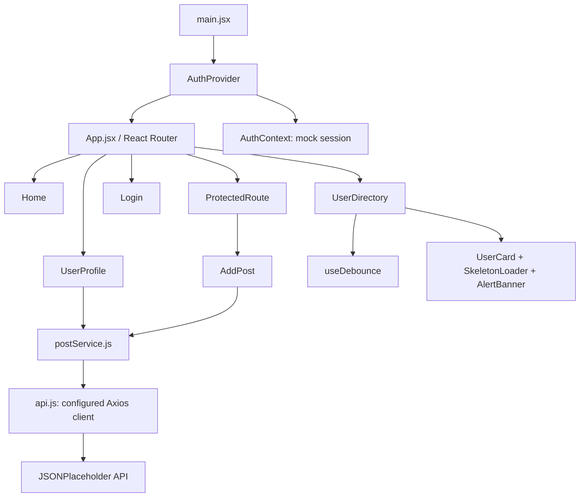

# DevDirectory — Project Report Outline

**Course:** Modern Frontend Frameworks  
**Project:** DevDirectory  
**Stack:** React 18, React Router v6, Axios, Tailwind CSS, Lucide React  
**API:** JSONPlaceholder

## 1. Overview
DevDirectory is a responsive single-page application for discovering developers, viewing their profiles and authored posts, and publishing team updates behind a mock authenticated session.

## 2. Architecture diagram

## 3. Features and acceptance criteria
- Public routes: `/`, `/users`, `/users/:id`, `/login`; unmatched routes display a 404 page.
- Protected `/add-post`: unauthenticated users are redirected to `/login` with the original route stored in router state. After successful mock login, the user is redirected back to that route.
- Search: debounced live filtering matches developer name and company.
- API: all remote requests pass through one configured Axios instance.
- Network lifecycle: skeleton loaders, retryable and dismissible error alerts, and success feedback.
- Controlled form: author dropdown is loaded dynamically; title is 5–80 characters; body is 20–500 characters; POST payload is `{ title, body, userId }`; HTTP 201 shows success and resets the form.

## 4. Data flow
Pages call functions in `services/postService.js`. The service functions use the shared `api.js` Axios instance. React state controls loading, errors, search input, form fields, and feedback. `AuthContext` shares session state with the navbar and protected route.

## 5. Authentication note
Authentication is intentionally simulated for this frontend assignment. The demo accepts a valid email and a password of at least four characters; a mock token is stored in local storage. This is not production-grade authentication and does not validate credentials against a backend.

## 6. API limitation
JSONPlaceholder returns a simulated response for `POST /posts`; submitted posts are not permanently stored on the remote service.

## 7. Screenshot checklist
Capture actual screenshots after running the project:
1. Home desktop view.
2. Directory loading state.
3. Directory search for “Leanne”.
4. Profile with posts.
5. Login and redirect to protected route.
6. Add Post validation and successful submission.
7. Error state (may be captured by temporarily disconnecting the network).
8. Mobile responsive view.

## 8. Self-evaluation
- Routing and protected route: implemented.
- Shared Axios service layer: implemented.
- Directory filtering: implemented.
- Profile metadata and posts: implemented.
- Controlled form and validation: implemented.
- Loading/error/retry/success lifecycle: implemented.
- Responsive styling and reduced-motion support: implemented.
- Deployment, repository URL, and runtime screenshots: complete these after local verification.
